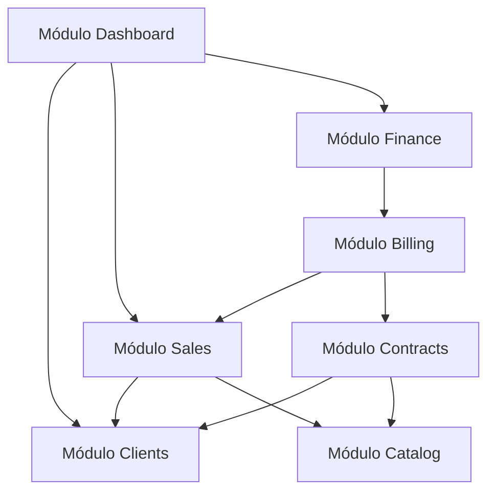

# Arquitetura do Sistema: Monólito Modular

## 1. Visão Geral Arquitetural

O Sistema ERP adota a arquitetura de **Monólito Modular** sobre o framework Next.js (App Router) e PostgreSQL relacional. A escolha do monólito modular fundamenta-se na necessidade de:
- **Consistência Transacional Forte (ACID):** Operações financeiras, liquidações e faturamentos requerem transações de banco atômicas (`BEGIN ... COMMIT`), sem a complexidade e latência de transações distribuídas (2PC/Sagas).
- **Simplicidade Operacional:** Deploy único, baixo custo de infraestrutura, facilidade de depuração e ausência de barramento distribuído desnecessário.
- **Fronteiras Claras de Domínio:** Cada módulo de negócio possui responsabilidades bem delimitadas, evitando dependências circulares e acoplamentos espaguete.

---

## 2. Camadas do Sistema

A organização do código em cada módulo (`src/modules/*`) e nas bibliotecas compartilhadas segue três níveis pragmáticos de separação, sem cerimônias excessivas:

```text
src/
├── app/                        # Camada de Apresentação & Roteamento (Next.js)
│   ├── (auth)/login/           # Autenticação e gestão de sessão
│   ├── (dashboard)/            # Rotas protegidas da aplicação
│   │   ├── clients/            # Telas de clientes
│   │   ├── catalog/            # Telas de produtos e serviços
│   │   ├── sales/              # Telas de vendas e contratações
│   │   ├── finance/            # Telas de títulos, contas e conciliação
│   │   └── page.tsx            # Dashboard inicial com indicadores
│   └── api/                    # Rotas de API HTTP / Webhooks controlados
│       └── health/route.ts     # Healthcheck técnico do sistema
├── modules/                    # Camada de Domínio & Casos de Uso
│   ├── clients/                # Entidades, contratos, repositórios e serviços de Clientes
│   ├── catalog/                # Gestão de produtos simples, variações e serviços
│   ├── sales/                  # Processamento de vendas e orçamentos
│   ├── contracts/              # Gestão de contratos de fornecimento e recorrências
│   ├── billing/                # Mecanismo idempotente de geração de faturamento
│   ├── finance/                # Títulos (Pagar/Receber), liquidações parciais, movimentos
│   └── dashboard/              # Agregação de métricas analíticas e fluxo de caixa
├── lib/                        # Camada de Infraestrutura
│   ├── db/                     # Pool PostgreSQL (pg), migrações e transações
│   ├── auth/                   # Criptografia de senhas e gestão de cookies seguros
│   └── env.ts                  # Parsing estrito de variáveis de ambiente com Zod
└── shared/                     # Tipos compartilhados, helpers monetários e constantes
```

---

## 3. Matriz de Dependências entre Módulos

Para preservar o desacoplamento, a comunicação entre domínios obedece às seguintes regras de dependência:



- **Regra de Ouro:** O módulo `Finance` **não** conhece detalhes de itens de estoque ou atributos físicos de variações de produto. Ele conhece apenas clientes (devedores/credores), valores, vencimentos, competências, contas financeiras e categorias financeiras.
- **Faturamento como Elo:** O módulo `Billing` é a ponte responsável por transformar vendas fechadas e períodos de contratos recorrentes em títulos financeiros a receber.

---

## 4. Segurança e Autenticação

1. **Sessões no Servidor:** Sessões baseadas em tokens seguros armazenados em cookies `HttpOnly`, `SameSite=Lax` (ou `Strict`) e com flag `Secure` obrigatória em produção.
2. **Hash de Senha:** Proibido hash caseiro. Utilização de Argon2id ou Bcrypt com fator de custo adequado.
3. **Autorização Centralizada:** Verificação de permissões executada obrigatoriamente no servidor (em Server Actions, Route Handlers ou services), mesmo quando elementos visuais da interface estiverem ocultos.
4. **Proteção Contra Injeção SQL:** Toda consulta utiliza parametrização estrita (`$1, $2, ...`) gerenciada pelo driver `pg`. Proibida qualquer interpolação direta de strings em comandos SQL.
5. **Menor Privilégio:** Usuário do banco de dados na aplicação possui permissões restritas a `SELECT, INSERT, UPDATE, DELETE` nas tabelas de negócio, sem privilégios de superusuário (`SUPERUSER` ou `ALTER SYSTEM`).
