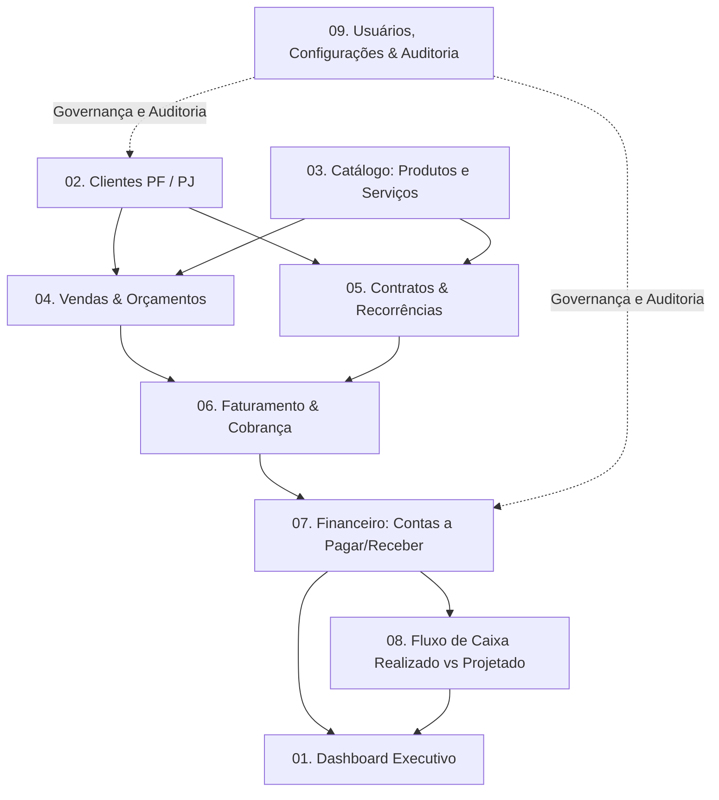

# Visão de Produto: Sistema ERP Comercial e Financeiro

## 1. Declaração de Visão
O **Sistema ERP** é uma plataforma de gestão empresarial focada em simplicidade operacional, rastreabilidade financeira absoluta e integridade de dados. Projetado como um monólito modular web em Next.js e PostgreSQL, o sistema atende pequenas e médias operações que demandam gestão integrada de clientes, vendas de produtos e serviços, cobranças recorrentes, contas a pagar e a receber, e conciliação de fluxo de caixa, eliminando planilhas fragmentadas e retrabalho contábil.

---

## 2. Personas e Atores do Sistema

| Persona | Papel | Objetivos Principais | Dores que o ERP Resolve |
| :--- | :--- | :--- | :--- |
| **Gestor Comercial** | Vendedor / Operador | Cadastrar clientes, orçar vendas, formalizar contratações recorrentes com preços específicos. | Perda de histórico de preços negociados, falta de clareza sobre status de clientes. |
| **Analista Financeiro** | Operador de Contas | Acompanhar títulos a pagar e a receber, registrar baixas parciais ou integrais, estornar lançamentos incorretos de forma auditada. | Cobranças em atraso sem controle, divergência entre faturamento emitido e dinheiro real em caixa. |
| **Diretor / Proprietário** | Tomador de Decisão | Analisar fluxo de caixa realizado vs. projetado, clientes ativos/inativos, saúde do negócio em tempo real. | Relatórios atrasados, números não confiáveis gerados por planilhas desconexas. |
| **Administrador do Sistema** | Suporte Técnico / TI | Gerenciar usuários, perfis de acesso (RBAC), auditar alterações sensíveis e garantir integridade do banco. | Falta de trilhas de auditoria, acessos indevidos a dados financeiros. |

---

## 3. Escopo Funcional de Longo Prazo

O ERP está estruturado conceitualmente em 9 módulos principais:

### Detalhamento dos Módulos

1. **Dashboard:**
   - Métricas em tempo real: clientes cadastrados, ativos e inativos.
   - Indicadores financeiros: faturamento do mês, total a receber (em dia e vencido), total a pagar, saldo atual em contas financeiras.
   - Gráfico de fluxo de caixa realizado vs. projetado para os próximos 30/60 dias.

2. **Clientes:**
   - Suporte nativo a Pessoa Física (`PF`) e Pessoa Jurídica (`PJ`).
   - Normalização e validação de CPF e CNPJ (sem obrigatoriedade prematura no cadastro preliminar).
   - Busca textual por nome, razão social, nome fantasia, documento, e-mail e telefone.
   - Soft delete e histórico de relacionamentos.

3. **Catálogo de Produtos e Serviços:**
   - Produtos simples com SKU, preço base e unidade de medida.
   - Produtos com variações (ex: cor, tamanho, voltagem) com atributos dinâmicos e preços próprios.
   - Serviços com precificação base e compatibilidade com faturamento avulso ou recorrente.
   - Histórico de preços preservado na venda (preço de catálogo não altera histórico).

4. **Vendas e Contratações:**
   - Múltiplas contratações por cliente.
   - Itens de venda e contrato com snapshot imutável de valores negociados e data efetiva.
   - Periodicidades suportadas: `ONE_TIME` (avulso), `MONTHLY` (mensal) e `YEARLY` (anual).
   - Ciclo de vida de contratos: `DRAFT`, `ACTIVE`, `SUSPENDED`, `CANCELED`, `COMPLETED`.

5. **Recorrências e Faturamento:**
   - Geração idempotente de títulos financeiros periódicos.
   - Regra estrita para vencimentos em dias 29, 30 e 31 ajustados no último dia de meses mais curtos.
   - Prevenção garantida contra cobrança duplicada no mesmo período (`contract_id` + `period_key`).

6. **Financeiro (Títulos e Liquidações):**
   - Contas a pagar e contas a receber desacopladas.
   - Títulos com suporte a pagamentos integrais e parciais.
   - Registro de liquidações vinculado a contas bancárias/caixas reais.
   - Estornos exclusivamente auditáveis (sem deleção física).
   - Transferências internas entre contas financeiras (sem efeito na DRE).

7. **Fluxo de Caixa:**
   - Separação mandatória entre regime de caixa (movimentação real de saldo) e competência.
   - Projeção baseada em títulos abertos com vencimento futuro.
   - Conciliação entre movimentações e saldos declarados das contas.

8. **Relatórios Básicos:**
   - Extrato por conta financeira.
   - Relatório de inadimplência e títulos vencidos.
   - Demonstrativo simplificado de receitas e despesas por categoria.

9. **Usuários, Configurações e Auditoria:**
   - Autenticação segura com credenciais criptografadas e sessões em cookie seguro HttpOnly.
   - RBAC (Role-Based Access Control) mínimo (`ADMIN`, `FINANCE`, `SALES`, `OPERATOR`).
   - Tabela centralizada de auditoria (`audit_logs`) registrando autor, entidade, operação, timestamp e payload anterior/novo.
